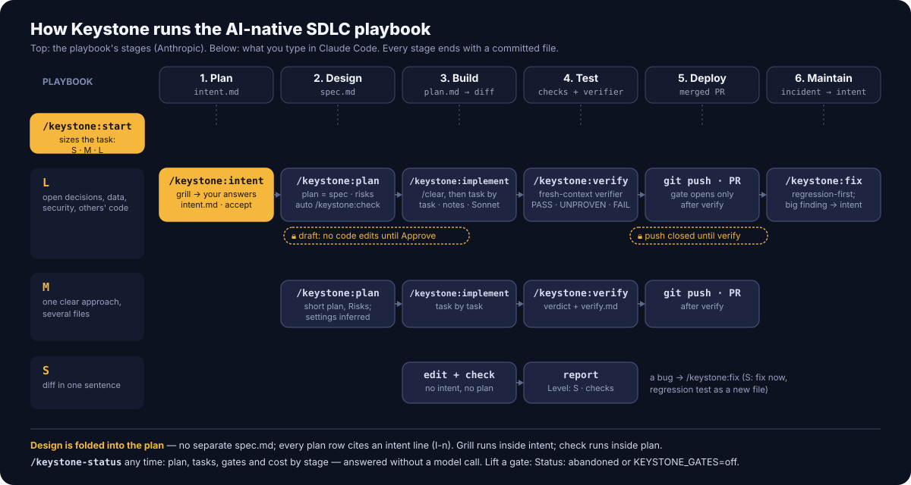

<div align="center">

<picture>
  <source media="(prefers-color-scheme: dark)" srcset="assets/keystone-dark.svg">
  <source media="(prefers-color-scheme: light)" srcset="assets/keystone-light.svg">
  
</picture>

<p>
  <strong>Process sized to the change. Intent first, plan as the spec, an independent check before and after the code.</strong><br>
  <sub>S / M / L by the size of the change · Gates held by hooks, not prompts · Verify in a clean context · Plugin for Claude Code</sub>
</p>

<p>
  <a href="#install">Install</a> &nbsp;·&nbsp;
  <a href="#how-it-works">How it works</a> &nbsp;·&nbsp;
  <a href="#commands">Commands</a> &nbsp;·&nbsp;
  <a href="docs/scenarios.md">What to run next</a> &nbsp;·&nbsp;
  <a href="docs/skills.md">Reference</a> &nbsp;·&nbsp;
  <a href="CHANGELOG.md">Changelog</a>
</p>

<p>
  <a href="LICENSE"></a>
  <a href="https://code.claude.com/docs/en/plugins"></a>
  <a href="https://github.com/sattva2020/keystone/releases"></a>
</p>

English · [Русский](README.ru.md)

</div>

<hr>

## What it is

Keystone is a standalone Claude Code plugin that picks the amount of process by the size of the change. A small fix is
done at once and checked. A clear task goes through a short plan with risks. A task with open decisions runs the full
chain: `intent` → `plan` → independent check of the plan → `implement` → `verify` in a clean context.

The plan is the spec: there is no separate `spec.md`, and every row of the plan points back to a numbered intent line
(`I-1…`). Hard rules are held by hooks, not only by prompt text.

| Capability | What it gives you |
|---|---|
| **Process sized to the change** | `/keystone:start` sizes every task S, M or L. A one-line fix is edited and checked at once; only a task with open decisions runs the full chain. |
| **Intent in your words** | `grill` asks every decision that is yours, then `intent.md` records them as numbered `I-n` lines you sign off. Facts are found by the agent; decisions stay yours. |
| **The plan is the spec** | One `plan.md` with risks and a check per task, every row traced to an `I-n`. `/keystone:check` reviews it in clean contexts and reports intent coverage before you approve. |
| **Gates held by hooks** | No code edits while the plan is a draft, no `git push` or PR until verify passes. Plain Node hooks, not prompt text the model can talk itself out of. |
| **Independent verify** | A verifier that did not write the code gives every task and `I-n` a line: ok, missing, wrong or not proven. A checked box is not evidence; `PASS-UNPROVEN` instead of a claim it cannot back. |
| **Security in the chain** | `/keystone:security` audits OWASP Top 10:2025, LLM Top 10, agent/MCP config and supply chain; on L its gate sits under verify. |
| **Resume without replaying the chat** | Each stage ends in a committed file and a `Next:` command. The mod hands a long session to a clean one through the plan, offers a clean start when the prompt cache has gone cold, and counts cost per stage. |

## What you can use it for

| Use case | What it's for |
|---|---|
| **A feature with open decisions** | Your answers become `intent.md`, the plan is checked before Approve, verify runs in a clean context, push opens after PASS |
| **A bug** | `/keystone:fix`: a failing regression test in a new file first, then the smallest fix; committed tests stay locked |
| **A new or undocumented project** | `/keystone:setup` writes `CLAUDE.md`, rules and `.mcp.json`; then `architecture`, `docs`, `dockerize`, `ci` |
| **A check before deploy** | `/keystone:security` after auth, payments or input changes: `Security gate: pass \| warn \| fail` |
| **Testing by hand or by an agent** | `/keystone:qa` writes scenarios from the plan, `/keystone:qa-check human \| agent` runs them |
| **Mistakes that keep coming back** | `/keystone:evolve` turns them into `.claude/rules/` after your yes — only lessons with a proven effect or a repeat, each judged first; `/keystone:transfer` brings them from another project |
| **Coming back to a task** | `/keystone-status` names the plan and the next command; nothing to re-read in the chat |

Step-by-step routes for each: [What to run next — scenarios](docs/scenarios.md).

## Install

In Claude Code:

```text
/plugin marketplace add sattva2020/keystone
/plugin install keystone@keystone
```

Or from a shell:

```bash
claude plugin marketplace add sattva2020/keystone
claude plugin install keystone@keystone
```

Update: `claude plugin marketplace update keystone`, then `claude plugin update keystone@keystone`, then start a **new session** — an open session keeps the copy it loaded.

Try it without installing: `claude --plugin-dir <path-to-this-repo>`.

Requirements: Claude Code 2.1.218 or newer (skills with `background`), and Node.js on `PATH` for the hooks. The mod
(`/keystone-status` and the status line) needs Claude Code 2.1.287+ in the terminal or 2.1.286+ in Desktop; the hooks
work without it. Plugin skills are namespaced `keystone:`, so your personal skills in `~/.claude/skills` do not shadow
them.

## How it works

<picture>
  
</picture>

Keystone follows [Anthropic's AI-native SDLC playbook](https://claude.com/resources/articles/the-ai-native-sdlc-playbook):

| Playbook stage | Ends with | In Keystone |
|---|---|---|
| 1. Plan | `intent.md` | `/keystone:intent` — grill asks every decision that is yours, then writes intent in your words; you `accept` it |
| 2. Design | `spec.md` | folded into the plan: `/keystone:plan` writes requirements + design and runs `/keystone:check` (fresh-context analyzer + validator) before you approve |
| 3. Build | `plan.md`, then the diff | Approve, `/clear`, `/keystone:implement`: task by task; no code while the plan is draft (hook) |
| 4. Test | checks + fresh-context verifier | `/keystone:verify`: runs your build/test/lint, then an independent verifier: PASS · PASS-UNPROVEN · FAIL |
| 5. Deploy | merged PR | `git push` / `gh pr create` stay closed until verify passes (hook). Release steps (merge, push, deploy, production jobs) live in the plan's `## Release`, not in its tasks; after verify, `/keystone:implement` runs them in release mode, each one after your yes — the agent prepares the release, you authorize it |
| 6. Maintain | incident → new `intent.md` | `/keystone:fix` (regression test first), or a new `/keystone:intent` when the finding is bigger |

Not every change needs all six: `/keystone:start` sizes it first. **S** — edit and check. **M** — short plan, implement,
verify. **L** — the whole chain above.

Below the chain sits a row of tools you run when you need them: `setup` (project context), `architecture`, `docs`,
`security`, `review`, `dockerize`, `ci`, `evolve` / `transfer` (lessons into rules), `roadmap`, `ask` / `reference`,
`distill`, `qa` / `qa-check`. See the [full reference](docs/skills.md).

## See it in action

An L-level task, abridged:

```text
> /keystone:start add reminders for overdue invoices
  Level: L — several decisions are yours, touches data and notifications.
  Next: /keystone:intent → /keystone:plan → /clear → /keystone:implement → /keystone:verify
> yes
> /keystone:intent add reminders for overdue invoices
  (grill runs inside intent)
  Q1 — Who creates a reminder, the system or the user?   ➡️ Recommended: system — invoices already carry due_date (src/billing/invoice.ts:41)
  Q2 — …
  …
  Wrote docs/keystone/2026-10-12-invoice-reminders/intent.md — I-1…I-9. Read it whole and correct me.
> /keystone:intent accept docs/keystone/2026-10-12-invoice-reminders/intent.md
> /keystone:plan docs/keystone/2026-10-12-invoice-reminders/intent.md
  Settings (inferred): tests — yes · logging — standard · docs — no
  Done means: npm test green; a reminder row appears for an invoice 1 day overdue
  Risks: duplicate sends on retry · timezone of "overdue" · opt-out not stored yet
  Running /keystone:check (analyzer + validator, clean contexts)…
  Coverage: 9/9 (100%) · 2 findings: task 4 depends on task 6; "snooze" in task 8 was not requested. Apply? > yes
  Approve plan? > Approve        (Status: draft → approved, baseline commit)
> /clear
> /keystone:implement
  Tasks 1–14: 13 done, 1 BLOCKED: staging SMTP not reachable.
  Blocked on me: staging SMTP.  Changed: 11 files.  Found: no opt-out flag in the schema.
> /keystone:verify
  Done means: 1 ok, 1 not proven (email delivery). I-1…I-9: ok 7 · not proven 2. Unrequested: none.
  Verdict: PASS-UNPROVEN → verify.md. git push stays closed until you prove it or /keystone:verify accept.
> /keystone-status
  Level L · implementing · tasks 13/14 · BLOCKED 1 · cost: plan $4.10 · check $3.20 · implement $2.30   (no model call)
```

## Choose your level

The agent proposes a level, you confirm it. Any single sign of L makes the task L.

| Level | Signs | Route | What you get |
|---|---|---|---|
| **S** | the diff fits in one sentence, no user-owned decisions, there is a way to check | edit → check → report; a bug goes through `/keystone:fix` | the change, a one-line `Level: S` report; no files |
| **M** | one obvious approach, several files | `/keystone:plan <task>` → Approve → `/keystone:implement` → `/keystone:verify` | `plan.md` with a 3-line Risks block, `verify.md` |
| **L** | several decisions; data or schema; security; other teams' modules; unclear "done" | `/keystone:intent` → `/keystone:plan <intent>` (with `/keystone:check`) → Approve → new session → `/keystone:implement` → `/keystone:verify` | `intent.md`, `plan.md` with Coverage, `verify.md` |

Model per role: **Opus** judges (grill, intent, plan, check, and the verifier inside verify); **Sonnet** runs implementation
from an approved plan and the verify run itself; fixed mechanical steps run as scripts (verify's facts come from
`collect.mjs`), and **Haiku** does fact lookups. The `effort` in a skill's frontmatter applies only to the turn that invokes it; for
long multi-turn plan, grill and check sessions set `/effort high` for the session.

Keystone never asks about tests, logging or docs. The plan infers them from the repository and writes a `Settings:`
line in its header; you can change it at Approve.

## What to run next

Every Keystone answer ends with a `Next:` line — the exact command with paths, or "nothing now — waiting for …".
When more than one next step makes sense, the stage first opens a menu (recommended option first) and carries
out what you pick; statuses in reports are colored: ✅ ⚠️ ❌, 🟢 🟡 🔴.
The same command appears as the dim prompt suggestion (Tab takes it), and `/keystone-status` shows it any time.
For every situation — a plan in draft, a verify FAIL, "I only ran grill", "back after a break", "waiting for a deploy" —
see **[What to run next — scenarios](docs/scenarios.md)**.

## Commands

All 25 commands in five groups; each one with its parameters, model and "when to use" is in the
[skills reference](docs/skills.md).

| Group | Commands |
|---|---|
| **Task chain** | `start` · `grill` · `intent` · `plan` · `check` · `implement` · `verify` · `fix` |
| **Project context** | `setup` · `architecture` · `docs` |
| **Checks and quality** | `security` · `review` · `qa` · `qa-check` · `ask` · `pentest` · `optimize` |
| **Build and ship** | `dockerize` · `ci` |
| **Lessons and knowledge** | `roadmap` · `evolve` · `transfer` · `reference` · `distill` |

Every command is `/keystone:<name>`, for example `/keystone:plan <intent or task>`.

## Gates (hooks)

Gates apply only while there is an active plan. While it is `draft`, code edits outside the task folder are denied;
`git push` and `gh pr create` for the plan's commits stay closed until `/keystone:verify` returns PASS; in a fix,
committed tests are locked. Release steps (`## Release`) run after verify, each after your yes. To lift a gate:
`Status: abandoned` in the plan or `KEYSTONE_GATES=off`. Task files live in `docs/keystone/<YYYY-MM-DD>-<slug>/`.

Every gate, release mode and the plan status flow: [`docs/gates.md`](docs/gates.md).

## Benchmarks

Measured on a real-world Next.js + NestJS + Supabase monorepo, in fresh isolated clones:

- plan check: 6 real findings and 0 false against 2 real and 1 false for AI Factory `improve +check`, same two plans,
  comparable cost;
- gates held live: a draft-plan code edit and a `git push` were both denied;
- S level cost about $1 on Sonnet; `verify` returns `PASS-UNPROVEN` instead of claiming what it did not prove;
- the grill benchmark is inconclusive (the user simulator leaked decisions).

Method, tables and limits: [`docs/benchmarks.md`](docs/benchmarks.md).

## Status and cost (mod)

A small TypeScript mod next to the hooks: `/keystone-status` and a status line with the plan, tasks and cost per stage
(no model call), the next command in the prompt box and as buttons, handoff to a clean session through the plan, and
a **Start clean** offer when the prompt cache has gone cold. Needs Claude Code 2.1.287+ (terminal) or 2.1.286+ (Desktop).

Every element, thresholds and the interface language option: [`docs/mod.md`](docs/mod.md).

## Integrations

- **[memlab](https://github.com/sattva2020/memlab) (optional, a separate plugin).** Project memory: code and
  decision search over a symbol graph. Install it next to Keystone:

  ```text
  /plugin marketplace add sattva2020/memlab
  /plugin install memlab@memlab
  ```

  Keystone does not install or configure it. When memlab's tools are present in a session, `grill`, `intent`, `plan`,
  `check` and `fix` use `search_decisions` / `search_code` for prior decisions and code locations, and `fix` records the
  lesson with `add_note`. Without memlab everything works as before.

- **[Dokploy MCP](https://github.com/sattva2020/dokploy-mcp) (optional, `@sattva/dokploy-mcp`).** The whole Dokploy API
  through 4 gateway tools (~1% of the context): deploy, logs, domains, databases, backups. When the project deploys on
  Dokploy, `/keystone:setup` proposes it for the project `.mcp.json` (`${DOKPLOY_URL}`, `${DOKPLOY_API_KEY}`), and
  `/keystone:dockerize` mentions it in its summary.

## Built on

- [The AI-native SDLC playbook](https://claude.com/blog/the-ai-native-sdlc-playbook) (Anthropic): each stage ends in a
  committed file, the next stage starts by reading it, and review happens in a fresh context so the verdict is not
  shaped by the assumptions that produced the code.
- [Claude Code best practices](https://code.claude.com/docs/en/best-practices): skip the plan when the diff fits in a
  sentence, give Claude a way to verify its work, use hooks for hard rules, research in subagents, implement in a new
  session, review in a clean context.

Adapted: the playbook has a `spec.md` between intent and plan; Keystone drops it, **the plan is the spec**. The S/M/L
levels are new here.

Credits: 21 skills are ported from [AI Factory](https://github.com/lee-to/ai-factory) 2.19.0 (MIT) and reworked, 5 of
its skills are replaced by Claude Code mechanisms and 6 are skipped; what was taken and why is in
[`docs/ai-factory.md`](docs/ai-factory.md). Attribution: [`THIRD_PARTY_NOTICES.md`](THIRD_PARTY_NOTICES.md). Keystone is not affiliated with KeystoneJS or keystone-engine.

## Known limitations

- Hooks were tested on Windows (PowerShell and Git Bash). macOS and Linux are untested; the CI matrix runs the unit
  tests on both, but live runs are not covered.
- The headless test harness needs your own project and your own scenarios; none ship with the repo.
- The grill benchmark is inconclusive, so "better than a general grilling skill" is not claimed.
- Results come from one corpus with one run per scenario.

## Contributing, feedback, security

- Read [`CONTRIBUTING.md`](CONTRIBUTING.md) before opening a PR; start with an issue or a Discussion.
- Share how it went for you via the *Feedback* issue form or [Discussions](https://github.com/sattva2020/keystone/discussions).
- Report vulnerabilities privately, see [`SECURITY.md`](SECURITY.md). Community rules: [`CODE_OF_CONDUCT.md`](CODE_OF_CONDUCT.md).
- Version history: [`CHANGELOG.md`](CHANGELOG.md).
## License

MIT, see [`LICENSE`](LICENSE). Parts derived from AI Factory 2.19.0 are MIT as well; see
[`THIRD_PARTY_NOTICES.md`](THIRD_PARTY_NOTICES.md).
