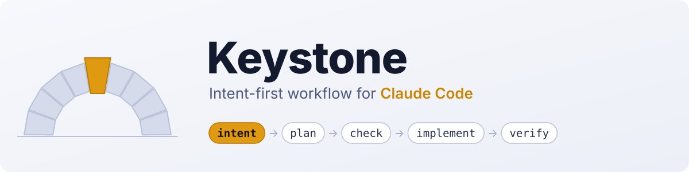

<div align="center">

<picture>
  <source media="(prefers-color-scheme: dark)" srcset="assets/keystone-dark.svg">
  <source media="(prefers-color-scheme: light)" srcset="assets/keystone-light.svg">
  
</picture>

**Process sized to the change. Intent first, plan as the spec, an independent check before and after the code.**

[](LICENSE)
[](https://code.claude.com/docs/en/plugins)
[](https://github.com/sattva2020/keystone/actions/workflows/ci.yml)
[](https://github.com/sattva2020/keystone/releases)

English | [Русский](README.ru.md)

</div>

## What it is

Keystone is a standalone Claude Code plugin that picks the amount of process by the size of the change. A small fix is
done at once and checked. A clear task goes through a short plan with risks. A task with open decisions runs the full
chain: `intent` → `plan` → independent check of the plan → `implement` → `verify` in a clean context.

The plan is the spec: there is no separate `spec.md`, and every row of the plan points back to a numbered intent line
(`I-1…`). Hard rules are held by hooks, not only by prompt text.

## Install

In Claude Code:

```text
/plugin marketplace add sattva2020/keystone
/plugin install keystone@keystone
```

Or from a shell:

```bash
claude plugin marketplace add sattva2020/keystone
claude plugin install keystone@keystone
```

Try it without installing: `claude --plugin-dir <path-to-this-repo>`.

Requirements: Claude Code 2.1.218 or newer (skills with `background`), and Node.js on `PATH` for the hooks. Plugin
skills are namespaced `keystone:`, so your personal skills in `~/.claude/skills` do not shadow them.

## See it in action

An L-level task, abridged:

```text
> /keystone:start add reminders for overdue invoices
  Level: L — several user-owned decisions, touches data and notifications. Proposing: intent → plan → check → implement → verify.
> yes
> /keystone:intent
  Grill, round 1: Who creates a reminder, the system or the user? (recommended: system) ...
  ...
  Wrote docs/keystone/2026-10-12-invoice-reminders/intent.md — 9 lines, I-1…I-9. Sign off?
> accept
> /keystone:plan docs/keystone/2026-10-12-invoice-reminders/intent.md
  Reconciliation: I-1…I-9 → 14 plan rows. Rules check: 1 conflict (logging) — resolved.
  Risks: 1) duplicate sends on retry 2) timezone of "overdue" 3) opt-out is not stored yet
  Plan written: Level: L · Mode: feature · Status: draft. Approve?
> /keystone:check
  Coverage: 9/9 intent lines (100%). Findings: 2 real — task 4 depends on task 6; "snooze" in task 8 was not requested.
  Edit the plan? > yes
> Approve plan            (Status: draft → approved)
> /clear → /keystone:implement
  Tasks 1–14 done, 13 checked. 1 BLOCKED: staging SMTP not reachable.
  Blocked on me: staging SMTP. Changed: 11 files. Found: opt-out flag missing in schema.
> /keystone:verify
  I-1…I-9: ok 7 · not proven 2 (email delivery). unrequested: none.
  Verdict: PASS-UNPROVEN → docs/keystone/2026-10-12-invoice-reminders/verify.md
```

## Choose your level

The agent proposes a level, you confirm it. Any single sign of L makes the task L.

| Level | Signs | Route | What you get |
|---|---|---|---|
| **S** | the diff fits in one sentence, no user-owned decisions, there is a way to check | edit → check → report; a bug goes through `/keystone:fix` | the change, a one-line `Level: S` report; no files |
| **M** | one obvious approach, several files | `/keystone:plan <task>` → Approve → `/keystone:implement` → `/keystone:verify` | `plan.md` with a 3-line Risks block, `verify.md` |
| **L** | several decisions; data or schema; security; other teams' modules; unclear "done" | `/keystone:intent` → `/keystone:plan <intent>` (with `/keystone:check`) → Approve → new session → `/keystone:implement` → `/keystone:verify` | `intent.md`, `plan.md` with Coverage, `verify.md` |

Model per stage: **Opus** for grill, intent, plan, check and verify; **Sonnet** for implementation from an approved
plan; **Haiku** for fact lookups. The `effort` in a skill's frontmatter applies only to the turn that invokes it; for
long multi-turn plan, grill and check sessions set `/effort high` for the session.

Keystone never asks about tests, logging or docs. The plan infers them from the repository and writes a `Settings:`
line in its header; you can change it at Approve.

## Commands

| Command | What it does |
|---|---|
| `/keystone:start <task>` | sizes the change S/M/L, picks the route and an exploration budget; irreversible external actions only after their preconditions are checked |
| `/keystone:grill [topic]` | interviews you in rounds over the whole decision tree (implementation, UX, edge cases, failures, data, security, trade-offs, what "done" means). The agent finds facts, you make decisions |
| `/keystone:intent [idea]` · `accept <path>` | writes `intent.md` in the author's words: numbered `I-n` lines, a decision log, a human sign-off |
| `/keystone:plan <intent or task>` | reconciliation table against the intent, rules check, Risks, tasks with files and checks, Approve with a base commit |
| `/keystone:check [intent] [plan]` | independent check in clean contexts: an analyzer (code, library versions, deploy and env, privacy, computations, platforms) and a validator; intent Coverage %; edits the plan only after you answer |
| `/keystone:implement [plan]` | tasks in order with `[x]` after each, resumable after `/clear`; plan drift is fixed in the plan in the same commit; literal `BLOCKED:`; a line-by-line report |
| `/keystone:fix <bug>` | regression first: reproduce, write a failing test in a new file, fix, same check green. S goes straight, M through a plan |
| `/keystone:verify [plan]` · `accept` | build, tests, lint, then a verifier in a clean context: ok / missing / wrong / not proven / BLOCKED per row, unrequested work, an adversarial pass over changed logic. Verdict PASS / PASS-UNPROVEN / FAIL, saved to `verify.md` |

## Gates (hooks)

Gates apply only while there is an **active plan**: the `plan.md` in the newest task folder whose status is `draft`,
`approved` or `implementing`. With no active plan, an S-level change is never blocked.

| When | What is denied |
|---|---|
| plan is `draft` | code edits outside the task folder until the plan is approved |
| fix is `implementing` | edits to test files already committed in `HEAD` (a new regression test file is fine) |
| plan is `implementing` and `## Tasks` has `[ ]` without `BLOCKED:` | ending the turn: one reminder, it never blocks a question to you |
| any active plan | `git push` and `gh pr create` until `/keystone:verify` returns PASS, or `/keystone:verify accept` |

To lift a gate, set `Status: abandoned` in the plan header, or run with `KEYSTONE_GATES=off`. The hooks are plain Node
scripts (`hooks/gate.mjs`) and read only the hook payload and the plan files.

## Files

Task files live in `docs/keystone/<YYYY-MM-DD>-<slug>/` — `intent.md`, `plan.md`, `verify.md` — or in `paths.specs`
when the project uses AI Factory. The plan header is `Level · Mode · Status` (plus `Settings:` and `Done means:`), and
Status moves `draft → approved → implementing → verified`, or `abandoned` at any point. Each stage ends in a committed
file and the next stage starts by reading it, not by replaying the chat.

## Benchmarks

Measured on a real-world Next.js + NestJS + Supabase monorepo, in fresh isolated clones:

- plan check: 6 real findings and 0 false against 2 real and 1 false for AI Factory `improve +check`, same two plans,
  comparable cost;
- gates held live: a draft-plan code edit and a `git push` were both denied;
- S level cost about $1 on Sonnet; `verify` returns `PASS-UNPROVEN` instead of claiming what it did not prove;
- the grill benchmark is inconclusive (the user simulator leaked decisions).

Method, tables and limits: [`docs/benchmarks.md`](docs/benchmarks.md).

## Integrations

- **memlab MCP (optional).** When a memlab server is connected, the skills use `search_decisions` and `search_code`
  for prior decisions and code locations, and `add_note` to record project decisions. Without it everything still
  works.
- **AI Factory adapter (frozen).** For projects where `/aif-plan` writes the plan, `adapters/ai-factory` injects the
  Keystone rules into `/aif-plan`, `/aif-implement` and `/aif-verify`. Install with
  `ai-factory extension add <repo>/adapters/ai-factory`. New mechanics land only in the plugin.

## Built on

- [The AI-native SDLC playbook](https://claude.com/blog/the-ai-native-sdlc-playbook) (Anthropic): each stage ends in a
  committed file, the next stage starts by reading it, and review happens in a fresh context so the verdict is not
  shaped by the assumptions that produced the code.
- [Claude Code best practices](https://code.claude.com/docs/en/best-practices): skip the plan when the diff fits in a
  sentence, give Claude a way to verify its work, use hooks for hard rules, research in subagents, implement in a new
  session, review in a clean context.

Adapted: the playbook has a `spec.md` between intent and plan; Keystone drops it, **the plan is the spec**. The S/M/L
levels are new here.

Credits: the plan, check, implement, fix and verify skills are derived from
[AI Factory](https://github.com/lee-to/ai-factory) 2.19.0 (MIT) and reworked; see
[`THIRD_PARTY_NOTICES.md`](THIRD_PARTY_NOTICES.md). Keystone is not affiliated with KeystoneJS or keystone-engine.

## Known limitations

- Hooks were tested on Windows (PowerShell and Git Bash). macOS and Linux are untested; the CI matrix runs the unit
  tests on both, but live runs are not covered.
- The headless test harness needs your own project and your own scenarios; none ship with the repo.
- The grill benchmark is inconclusive, so "better than a general grilling skill" is not claimed.
- Results come from one corpus with one run per scenario.

## Contributing, feedback, security

- Read [`CONTRIBUTING.md`](CONTRIBUTING.md) before opening a PR; start with an issue or a Discussion.
- Share how it went for you via the *Feedback* issue form or [Discussions](https://github.com/sattva2020/keystone/discussions).
- Report vulnerabilities privately, see [`SECURITY.md`](SECURITY.md). Community rules: [`CODE_OF_CONDUCT.md`](CODE_OF_CONDUCT.md).
- Version history: [`CHANGELOG.md`](CHANGELOG.md).
## License

MIT, see [`LICENSE`](LICENSE). Parts derived from AI Factory 2.19.0 are MIT as well; see
[`THIRD_PARTY_NOTICES.md`](THIRD_PARTY_NOTICES.md).
