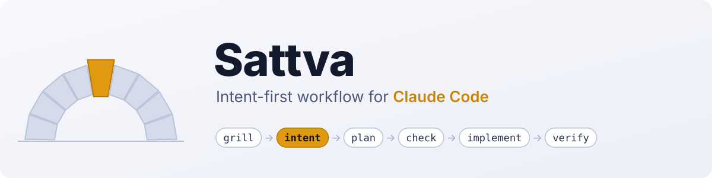
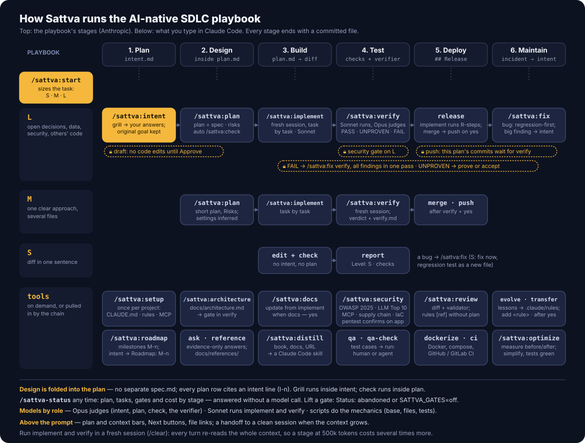

<div align="center">

<picture>
  <source media="(prefers-color-scheme: dark)" srcset="assets/sattva-dark.svg">
  <source media="(prefers-color-scheme: light)" srcset="assets/sattva-light.svg">
  
</picture>

**Процесс по размеру задачи. Сначала intent, план как спека, независимая проверка до кода и после.**

formerly Keystone

[](LICENSE)
[](https://code.claude.com/docs/en/plugins)
[](https://github.com/sattva2020/sattva-plugin/releases)

[English](README.md) | Русский

</div>

## Что это

Sattva — самостоятельный плагин Claude Code: процесс подбирается по размеру задачи. Мелочь делается сразу и
проверяется. Понятная задача идёт через короткий план с рисками. Задача с открытыми решениями проходит всю цепочку:
`intent` → `plan` → независимая проверка плана → `implement` → `verify` в чистом контексте.

План и есть спека: отдельного `spec.md` нет, а каждая строка плана ссылается на пронумерованную строку intent
(`I-1…`). Жёсткие правила держат хуки, а не только текст скиллов.

## Установка

В Claude Code:

```text
/plugin marketplace add sattva2020/sattva-plugin
/plugin install sattva@sattva
```

Или из shell:

```bash
claude plugin marketplace add sattva2020/sattva-plugin
claude plugin install sattva@sattva
```

Обновление: `claude plugin marketplace update sattva`, затем `claude plugin update sattva@sattva`, затем **новая сессия** — открытая сессия держит ту копию, которую загрузила.

Разовая проба без установки: `claude --plugin-dir <путь-к-репозиторию>`.

Требования: Claude Code 2.1.218 или новее (skills с `background`) и Node.js в `PATH` для хуков. Моду
(`/sattva-status` и строка состояния) нужен Claude Code 2.1.287+ в терминале или 2.1.286+ в Desktop; хуки работают без
него. Скиллы плагина имеют префикс `sattva:`, поэтому личные скиллы из `~/.claude/skills` их не перекрывают.

## Как это работает

<picture>
  
</picture>

Sattva следует [плейбуку Anthropic AI-native SDLC](https://claude.com/resources/articles/the-ai-native-sdlc-playbook):

| Этап плейбука | Чем заканчивается | В Sattva |
|---|---|---|
| 1. Plan | `intent.md` | `/sattva:intent` — grill спрашивает все решения, которые за вами, и записывает intent вашими словами; вы делаете `accept` |
| 2. Design | `spec.md` | встроен в план: `/sattva:plan` пишет требования и дизайн и до утверждения запускает `/sattva:check` (анализатор + валидатор в чистом контексте) |
| 3. Build | `plan.md`, затем дифф | Approve, `/clear`, `/sattva:implement`: задача за задачей; пока план в draft, правки кода закрыты (хук) |
| 4. Test | проверки + проверяющий в чистом контексте | `/sattva:verify`: сборка, тесты, линтер, затем независимый проверяющий: PASS · PASS-UNPROVEN · FAIL |
| 5. Deploy | смёрженный PR | `git push` / `gh pr create` закрыты, пока verify не прошёл (хук). Шаги релиза (merge, push, деплой, задачи на проде) лежат в разделе плана `## Release`, а не в задачах; после verify `/sattva:implement` выполняет их в режиме релиза, каждый — после вашего «да»: агент готовит релиз, вы его разрешаете |
| 6. Maintain | инцидент → новый `intent.md` | `/sattva:fix` (сначала регрессионный тест) или новый `/sattva:intent`, если находка крупнее |

Не каждой задаче нужны все шесть этапов: сначала `/sattva:start` определяет размер. **S** — правка и проверка.
**M** — короткий план, реализация, проверка. **L** — вся цепочка выше.

Под цепочкой — ряд инструментов, которые запускаете по необходимости: `setup` (контекст проекта), `architecture`, `docs`,
`security`, `review`, `dockerize`, `ci`, `evolve` / `transfer` (уроки в правила), `roadmap`, `ask` / `reference`,
`distill`, `qa` / `qa-check`. Подробно — в [справочнике](docs/skills.ru.md).

## Как это выглядит

Задача уровня L, сокращённо:

```text
> /sattva:start напоминания о просроченных счетах
  Уровень L — решения за вами, затронуты данные и уведомления.
  Дальше: /sattva:intent → /sattva:plan → /clear → /sattva:implement → /sattva:verify
> да
> /sattva:intent напоминания о просроченных счетах
  (grill идёт внутри intent)
  Q1 — Кто создаёт напоминание: система или пользователь?   ➡️ Рекомендую: система — у счёта уже есть due_date (src/billing/invoice.ts:41)
  Q2 — …
  …
  Записан docs/sattva/2026-10-12-invoice-reminders/intent.md — I-1…I-9. Прочитайте целиком и поправьте.
> /sattva:intent accept docs/sattva/2026-10-12-invoice-reminders/intent.md
> /sattva:plan docs/sattva/2026-10-12-invoice-reminders/intent.md
  Settings (по репо): tests — yes · logging — standard · docs — no
  Done means: npm test зелёный; для счёта с просрочкой 1 день появляется строка напоминания
  Risks: повторная отправка при ретрае · часовой пояс «просрочки» · отписка пока не хранится
  Запускаю /sattva:check (анализатор + валидатор в чистых контекстах)…
  Покрытие 9/9 (100%) · 2 находки: задача 4 зависит от задачи 6; «snooze» в задаче 8 не просили. Применить? > да
  Утвердить план? > Approve        (Status: draft → approved, базовый коммит)
> /clear
> /sattva:implement
  Задачи 1–14: сделано 13, 1 BLOCKED: staging SMTP недоступен.
  Blocked on me: staging SMTP.  Changed: 11 файлов.  Found: в схеме нет флага отписки.
> /sattva:verify
  Done means: 1 ok, 1 not proven (доставка email). I-1…I-9: ok 7 · not proven 2. Unrequested: нет.
  Вердикт: PASS-UNPROVEN → verify.md. git push закрыт, пока не докажете или не сделаете /sattva:verify accept.
> /sattva-status
  Level L · implementing · задачи 13/14 · BLOCKED 1 · стоимость: plan $4.10 · check $3.20 · implement $2.30   (без вызова модели)
```

## Уровни

Уровень предлагает агент, подтверждает человек. Любой признак L делает задачу L.

| Уровень | Признаки | Маршрут | Что получаете |
|---|---|---|---|
| **S** | дифф в одно предложение, решений пользователя нет, есть проверка | правка → проверка → отчёт; баг — `/sattva:fix` | правка и строка `Level: S` в отчёте; файлов нет |
| **M** | один очевидный подход, несколько файлов | `/sattva:plan <задача>` → Approve → `/sattva:implement` → `/sattva:verify` | `plan.md` с Risks из трёх пунктов, `verify.md` |
| **L** | несколько решений; данные или схема; безопасность; чужие модули; неясное «готово» | `/sattva:intent` → `/sattva:plan <intent>` (с `/sattva:check`) → Approve → новая сессия → `/sattva:implement` → `/sattva:verify` | `intent.md`, `plan.md` с Coverage, `verify.md` |

Модель под этап: **Opus (судья)** — допрос, intent, план, check, верификатор внутри verify; **Sonnet (оркестратор)** —
реализация по одобренному плану и сам прогон verify; механика — скрипты (сбор фактов verify — `collect.mjs`), **Haiku** —
поиск фактов. `effort` из frontmatter скилла действует только в ход вызова; для многоходовых
plan/grill/check сессий ставьте `/effort high` на сессию.

Вопросов о тестах, логировании и документации нет. Plan выводит их из репозитория и пишет строкой `Settings:` в
шапке плана; поправить можно при Approve.

## Режим rush

Когда горят сроки и токенов не жалко: `/sattva:start --rush <задача>` (M → `/sattva:plan <задача> --rush`,
L → `/sattva:intent --rush <идея>`). В шапке плана появляется строка `Pace: rush`, и после Approve цепочка
implement → verify → fix → verify идёт сама, в том же ходе: без `/clear` и без ваших команд до вердикта.

- **Что делает.** Каждая стадия — субагент на Opus с effort high, он читает SKILL.md своей стадии; основная сессия
  только ведёт цепочку. Во время implement verifier в чистом контексте судит уже готовые задачи (ранняя проверка,
  раздел `early` в `agents/verifier.md`): находки чинятся до финального verify и видны строками `early check` в
  `## Implementation notes`; `verify.md` ранняя проверка не пишет и прогоном не считается. Вопросы до Approve — одним
  пакетом; после Approve — только конфликт требований, блокер для человека или необратимый шаг, в остальных меню
  берётся вариант Recommended.
- **Что остаётся за вами.** Подпись intent (L), Approve, accept, push, выпуск, `/sattva:review`. На третьем judged
  FAIL цепочка останавливается и показывает меню потолка.
- **Что не меняется.** Финальный verify полный и той же строгости; verifier независим; Security gate и запрет push до
  verify на месте; одна сессия на план; режим разрешений ваш. Потолка расходов нет.
- **Сбой** (лимит, упавшая стадия, отказ инструмента) → одна строка
  `Rush остановлен на <стадия>: <причина>. Продолжить: /sattva:implement <план>`; состояние — в плане и `verify.md`.
  Итог: `rush: <вердикт> · с одобрения <Hч Mмин> · прогонов verify <n> · токены стадий <n>`; стоимость сессии в
  долларах — `/sattva-status`.
- **Выключить** — убрать строку `Pace: rush` из шапки плана, дальше обычный путь. Включить на уже одобренном плане
  нельзя. Среда без субагентов → «rush недоступен: <причина>» и обычный путь.
- **Замер** — [бенчмарк 2026-11-21](benchmarks/results/2026-11-21-rush.md): на маленьких задачах, где обычная цепочка
  проходит с первого verify, rush медленнее по машинному времени (1.2–1.7×) и дороже;
  повтор реального плана из 7 задач — 1.33× медленнее,
  1.48× дороже, 3 прогона verify, как и без rush. Машинное время rush не сокращает; его выигрыш — одна команда вместо
  нескольких и ноль ожидания человека между стадиями. В `claude -p` и CI запускайте его с
  `CLAUDE_CODE_PRINT_BG_WAIT_CEILING_MS=0`: иначе фоновые стадии гасятся через 10 минут.

## Что запускать дальше

Каждый ответ Sattva заканчивается строкой `Next:` — точная команда с путями или «ничего — ждём …». Та же команда
появляется серой подсказкой в поле ввода (Tab вставляет её), а `/sattva-status` показывает её в любой момент.
Когда разумных шагов несколько, этап сначала открывает меню выбора (рекомендованный — первым), и выбранное
выполняется сразу; статусы в отчётах помечены цветом: ✅ ⚠️ ❌, 🟢 🟡 🔴.
Для каждой ситуации — план в draft, verify FAIL, «сделал только grill», «вернулся после перерыва», «ждём деплоя» —
смотрите **[Что запускать дальше — сценарии](docs/scenarios.ru.md)**.

## Команды

Все 27 команд по группам. Параметры в скобках; `|` — выбор.

**Цепочка задачи**

| Команда | Что делает |
|---|---|
| `/sattva:start [--rush] <задача>` | определяет уровень S/M/L и маршрут; `--rush` — [режим rush](#режим-rush) |
| `/sattva:grill [тема]` | допрашивает по всему дереву решений; возвращает список решений, файлов не пишет |
| `/sattva:intent [--rush] [идея]` · `accept <путь>` | `intent.md` вашими словами: строки `I-n`, журнал решений, подпись |
| `/sattva:plan <intent или задача> [S\|M\|L] [--rush]` | план и есть спека: сверка, правила проекта, Risks, задачи с проверками, Approve |
| `/sattva:check [intent] [план] [запрос]` | независимая проверка плана в чистых контекстах; % покрытия intent; свободный запрос после путей |
| `/sattva:implement [план]` | задачи по порядку, `BLOCKED:` вместо «не запускалось», журнал решений, продолжение после `/clear` |
| `/sattva:verify [план [base]] [--strict]` · `accept` | сборка, тесты, линт, затем проверяющий в чистом контексте; гейты архитектуры и безопасности; PASS / PASS-UNPROVEN / FAIL |
| `/sattva:fix <баг>` | сначала регрессия: падающий тест новым файлом, потом минимальный фикс. `/sattva:fix verify` — все находки последнего FAIL из `verify.md` за один проход |
| `/sattva:sessions` | разбор дочерних сессий главной: готовые архивируются сразу, недоделанным — одно сообщение с шагом агента, остальные — «ждут тебя» с причиной; запускается сам по событию приложения; в CLI — только показ |
| `/sattva:feedback [summary [--since X.Y.Z] \| judge [<план>] \| auto <план>]` | обратная связь агентов о тексте скиллов цепочки: сводка по всем проектам машины (повторяющиеся проблемы со счётчиком) и судья в чистом контексте, который сверяет самоотчёты со следами работы; Sonnet; выключено по умолчанию (настройка плагина `feedback`) |

**Контекст проекта**

| Команда | Что делает |
|---|---|
| `/sattva:setup [описание]` | пишет короткий `CLAUDE.md`, `.claude/rules/base.md` и `.mcp.json` проекта после диффа и «да»; импортирует готовый `AGENTS.md` |
| `/sattva:architecture [паттерн]` | подбирает архитектурный паттерн и пишет `docs/architecture.md` с grep-проверкой на каждое правило |
| `/sattva:docs [update <файлы\|темы>] [--web]` | README как лендинг и страницы в `docs/` по темам |

**Проверки и качество**

| Команда | Что делает |
|---|---|
| `/sattva:security [категория\|crypto\|logging\|iac\|agent\|supply-chain\|путь\|план] \| ignore <id> <причина>` | аудит по OWASP Top 10:2025 (с A04 криптографией и A09 логированием) и LLM Top 10 2026, агенты/MCP и собственный MCP-сервер, цепочка поставок, IaC/K8s, ссылки на CWE/ASVS/ISO; `Security gate: pass\|warn\|fail` |
| `/sattva:review [PR\|ref\|rules [ref]\|пусто = staged]` | ревью без правок; валидатор в чистом контексте перепроверяет каждую находку; `rules` — только правила MUST / MUST NOT по диффу, без плана |
| `/sattva:qa [--all] [change-summary\|test-plan\|test-cases] [план\|ref]` | сводка изменений, план тестов и ручные сценарии со ссылками на `I-n` |
| `/sattva:qa-check [human\|agent] [план\|папка qa\|ветка]` | прогоняет сценарии `qa`; pass / fail / blocked с доказательством |
| `/sattva:ask <вопрос>` | отвечает только по доказательствам, иначе `INSUFFICIENT INFORMATION` |
| `/sattva:pentest <URL вашей цели> [отчёт]` | подтверждает находки security на вашем работающем приложении (localhost / staging или URL, который вы назвали своим); один безопасный запрос на находку, повышает или понижает её |
| `/sattva:optimize perf <цель> \| simplify <путь>` | ускоряет или упрощает код по замерам: одна и та же команда до и после, правка остаётся только если цифры улучшились |

**Сборка и выкладка**

| Команда | Что делает |
|---|---|
| `/sattva:dockerize [--audit]` | Dockerfile, compose, усиленный production-оверлей; или аудит |
| `/sattva:ci [github\|gitlab] [--enhance]` | CI-пайплайн из инструментов, которые реально есть в проекте |

**Уроки и знания**

| Команда | Что делает |
|---|---|
| `/sattva:roadmap [check\|видение]` | `docs/roadmap.md` с вехами `M-n` |
| `/sattva:evolve [all\|этап\|тема\|add <правило>]` | превращает в правила `.claude/rules/` после «да» только уроки с доказанным эффектом или повтором (вердикт по каждому, иначе `NO_ENTRY`); `add` — одно правило под диктовку, с дедупом и `paths:` |
| `/sattva:transfer <путь к проекту> [all\|этап\|тема]` | переносит правила и уроки из другого вашего проекта |
| `/sattva:reference <url\|путь>… [--name] [--update]` · `list\|show\|delete` | справочник проекта: выводы, цены, лимиты с источником |
| `/sattva:distill <путь\|url>… [--name] [--path] [--update] [--split]` | превращает книгу или документы в скилл Claude Code |

Полный справочник с моделями, «когда применять» и «кто вызывает»: [`docs/skills.ru.md`](docs/skills.ru.md).

## Гейты (хуки)

Гейты действуют только при **активном плане** — это `plan.md` из самой свежей папки задачи со статусом `draft`,
`approved` или `implementing`. Без такого плана уровень S ничем не блокируется.

| Когда | Что запрещено |
|---|---|
| план в `draft` | правки кода вне папки задачи, пока план не одобрен |
| fix в `implementing` | правка тест-файлов, закоммиченных в `HEAD` (новый регрессионный тест писать можно) |
| план в `implementing`, в `## Tasks` остались `[ ]` без `BLOCKED:` | завершение хода: одно напоминание, вопросы человеку оно не блокирует |
| активный план, чьи коммиты уходят в push (коммиты, меняющие папку его задачи) | `git push`, `gh pr create` — до `/sattva:verify` с PASS или `/sattva:verify accept`; push, не несущий работу плана, проходит. В облачной сессии push в рабочую ветку (не основную) тоже проходит: облако хранит работу только на удалённой ветке; push в основную ветку и `gh pr create` закрыты. Так же закрыты PR, слияние PR и запись в основную ветку через инструменты GitHub MCP |

**Релиз после verify.** Push открывается только на verified-плане, поэтому шаги релиза никогда не лежат в `## Tasks` —
план держит их в `## Release` (`R1`, `R2`, …). Verify не считает их открытой работой; при PASS его `Next:` ведёт на
`/sattva:implement <план>`, который в **режиме релиза** выполняет только эти шаги, спрашивает ваше «да» перед каждым
merge, push или деплоем и оставляет план `verified`. Это правило плейбука: *«Агент делает всё до продакшен-ворот и
ничего за ними»*.

Гейты draft и Stop, статус-строка, кнопки и предложение handoff касаются только сессии, которая работает с планом: в ней был `/sattva:<стадия>` по этому плану или правка файлов его папки. Push-гейт общий для репозитория.

Снять гейт: `Status: abandoned` в шапке плана или запуск Claude Code с переменной окружения `SATTVA_GATES=off` (префикс перед одной командой до хука не доходит). Автозапуск разбора дочерних сессий выключается отдельно — `SATTVA_SESSIONS=off`; `SATTVA_GATES=off` его не трогает. Хуки — обычный Node-скрипт
(`hooks/gate.mjs`), читают только payload хука и файлы плана.

**Одна сессия на план.** `/sattva:implement` и `/sattva:fix` берут план до первой правки: запись владельца (место — папка worktree или облачная сессия, ветка, стадия, время) лежит в служебной ветке `sattva/owners` и уходит в origin, поэтому её видят другие worktree, другие машины и облако; рабочие ветки, `main` и папка плана не меняются, push-гейт не ослаблен. Вторая сессия на том же плане останавливается с сообщением, кто его ведёт, и спрашивает: `Стоп` или `Забрать план`. Владелец отмечается перед каждой задачей и коммитом; без отметки 2 ч запись протухла, и «Забрать план» становится рекомендованным ответом, но без вашего выбора (`claude -p`, CI) план не забирается. Забранная сессия видит это на следующей отметке и останавливается. Конец прогона, `verified` и `abandoned` снимают запись. Без сети или origin метка остаётся локальной (её видят worktree этой машины) с одним предупреждением. `SATTVA_GATES=off` выключает и эту защиту. `/sattva:sessions` не будит дочернюю сессию, если её план ведёт другая живая сессия.

**Конфликты между worktree.** На старте в linked worktree `/sattva:implement` (и `/sattva:fix`, когда исполняет fix-план) сам запускает `worktree-check`: статически, только чтением файлов, сравнивает со всеми живыми worktree репо (основной checkout тоже) host-порты, `container_name`, имя Compose-проекта, именованные тома и сети из `docker-compose*.yml` / `compose*.yml`, `.env*` (`*PORT*`, `COMPOSE_PROJECT_NAME`), `.claude/launch.json` и `scripts` в `package.json`. `${VAR}` подставляется из `.env` своего worktree; что не вычисляется (нет значения, диапазон портов, якоря YAML) — «не проверено», а не конфликт. Значения секретов в отчёт не попадают. Найден конфликт — implement показывает таблицу (ресурс, значение, worktree · файл:строка) и подсказку и продолжает: править код параллельно безопасно, сталкиваются только окружения, поднятые одновременно. Проверка не доказывает изоляцию и ничего не запускает, кроме `git`. Вручную: `node skills/implement/scripts/worktree-check.mjs [--json]`.

## Обратная связь агентов

По умолчанию выключена. Включается одной настройкой плагина `feedback` (`/config` → плагин sattva → `feedback`) или переменной `SATTVA_FEEDBACK=on`; `SATTVA_FEEDBACK=off` выключает всё насовсем (бенчмарки его ставят). Пока выключено, ни инструкции в контексте, ни файлов, ни судьи нет.

Включено: хук `SessionStart` добавляет в контекст короткую инструкцию, и скиллы start, intent, plan, check, implement, verify, fix и review в конце пишут самоотчёт о тексте скилла — по четырём вопросам (неясно / отступил и почему / додумал / лишнее), не больше 10 строк, на языке беседы. В чате — одна строка. Записи лежат в `~/.claude/sattva-feedback/<проект>/feedback.jsonl` (`SATTVA_FEEDBACK_DIR` меняет место): только на этой машине, только дописываются, автоочистки нет, **никуда не отправляются**; код проекта, содержимое его файлов и секреты в запись попадать не должны: инструкция запрещает их цитировать, а известные шаблоны секретов маскируются (лучшее усилие, D23). `/sattva:feedback` показывает сводку по всем проектам; судья (`/sattva:feedback judge <план>`) сверяет отчёты со следами работы и сам запускается после verify на M/L — один раз на задачу и только при признаках проблем.

## Файлы

Файлы задачи лежат в `docs/sattva/<YYYY-MM-DD>-<slug>/`: `intent.md`, `plan.md`, `verify.md` (папку
`.ai-factory/` от AI Factory Sattva не читает и не пишет). Шапка плана: `Level · Mode · Status` (плюс `Settings:` и `Done means:`),
Status проходит `draft → approved → implementing → verified`, а `abandoned` возможен на любом шаге; шаги `## Release`
выполняются, когда план уже `verified`. Каждый этап
заканчивается закоммиченным файлом, следующий начинается с его чтения, а не с переписки.

## Замеры

Реальный монорепозиторий Next.js + NestJS + Supabase, свежие изолированные клоны:

- проверка плана: 6 реальных находок и 0 ложных против 2 реальных и 1 ложной у AI Factory `improve +check` на тех же
  двух планах, стоимость сопоставима;
- гейты сработали вживую: правка кода при плане в draft и `git push` отклонены;
- уровень S — около $1 на Sonnet; `verify` честно возвращает `PASS-UNPROVEN`, а не заявляет непроверенное;
- замер grill не дал вывода (симулятор пользователя выдавал решения без вопроса).

Методика, таблицы и ограничения: [`docs/benchmarks.md`](docs/benchmarks.md) (на английском).

## Статус и стоимость (мод)

Рядом с хуками Sattva ставит небольшой [мод](https://code.claude.com/docs/en/plugins/mods) на TypeScript:

- **`/sattva-status`** — активный план, уровень, статус, сделанные задачи, число `BLOCKED`, `Done means`, какие гейты
  включены и сколько стоил каждый этап. Отвечает локально, без вызова модели.
- **Строка состояния** — `Sattva · L · implementing · 13/14 · $9.60` под полем ввода.
- **Боковая панель** (Desktop; в терминале и VS Code ошибок нет, но вид не гарантируется) — «Ждут вас» с причиной и
  следующей командой, субсессии этой сессии (этап, прогресс, работает или ждёт; чего узнать нельзя — «неизвестно»),
  план, проверки, расход. Кнопка только вставляет команду в поле ввода. Обновляется после хода и раз в 30 секунд, пока
  видна, без вызова модели; при сбое — прежние данные с отметкой «устарело». Открывается сама при плане или субсессиях,
  закрытую в этой сессии открывает `/sattva-panel`. Читает `~/.claude/sessions` (реестр живых сессий), список
  субсессий приложения, git и файлы планов; ничего не отправляет, тексты сообщений не читает, хранит только факт
  закрытия. Откат — опция плагина `panel` (Side panel): выключите, и панели, её команды и таймера нет.
- **Стоимость в полосе** — заголовок над полем ввода: `Sattva · L · implementing · $9.60`.
- **Счётчик стоимости** — после каждого хода прирост стоимости сессии прибавляется к этапу, который вы запускали
  (`/sattva:plan`, `check`, `implement`…), для активного плана; `implement` и `verify` получают измеренные цифры для
  строки `cost:`.
- **Следующая команда** — после хода Sattva в пустом поле ввода появляется серая подсказка следующего шага с уже
  подставленным путём к плану (`/sattva:implement docs/sattva/…/plan.md`, потом `/sattva:verify …`); Tab или →
  вставляет её.
- **Возврат после паузы** — кэш Claude живёт до часа; после него следующий ответ перечитывает всю историю по полной
  цене. Если с последнего хода прошло больше 55 минут, сессия работает с планом и контекст не меньше 30k, над полем
  ввода появляется полоса «Кэш остыл»: **«Начать чисто»** делает `/clear` без вызова модели (история не перечитывается,
  следующая команда плана встаёт в поле ввода, пропадает только то, что не записано в план); **«Записать и начать»** —
  обычная передача `/sattva-handoff`: одно перечитывание, агент дописывает план, потом `/clear`. Уходите больше чем
  на час — нажмите `/sattva-handoff` заранее, пока кэш тёплый: запись выйдет дешёвой.
- **Язык надписей** — полоса, кнопки и всплывающие сообщения мода по умолчанию на английском. Язык берётся из
  настройки Claude Code `language` (`"language": "russian"` в `settings.json`; понимает английское имя и самоназвание
  языка: `russian`/`русский`, `german`/`deutsch`, `french`/`français`, `spanish`/`español`); нет её или язык другой —
  английский. Явно задаётся опцией плагина `language`: `/config` → sattva → Interface language — `auto` (по
  умолчанию, из настройки), `en`, `ru`, `de`, `fr`, `es`. Строка без перевода показывается по-английски. Текст, который
  мод отправляет агенту при передаче, всегда английский. Переводы на de, fr и es машинные — правки приветствуются.

Моду нужен Claude Code 2.1.287+ в терминале или 2.1.286+ в Desktop. В `claude -p` хуки работают, но ничего не рисуется.

## Интеграции

- **[memlab](https://github.com/sattva2020/memlab) (необязательно, отдельный плагин).** Память проекта: поиск по коду
  и записям решений. Ставится рядом с Sattva:

  ```text
  /plugin marketplace add sattva2020/memlab
  /plugin install memlab@memlab
  ```

  Sattva его не ставит и не настраивает. Если инструменты memlab есть в сессии, `grill`, `intent`, `plan`, `check` и
  `fix` используют `search_decisions` / `search_code` для прошлых решений и мест в коде, а `fix` записывает урок через
  `add_note`. Без memlab всё работает как раньше.

- **[Dokploy MCP](https://github.com/sattva2020/dokploy-mcp) (по желанию, `@sattva/dokploy-mcp`).** Весь API Dokploy
  через 4 инструмента-шлюза (~1% контекста): деплой, логи, домены, базы, бэкапы. Если проект деплоится на Dokploy,
  `/sattva:setup` предложит его в проектный `.mcp.json` (`${DOKPLOY_URL}`, `${DOKPLOY_API_KEY}`), а
  `/sattva:dockerize` упомянет в итоге.

## На чём основан

- [The AI-native SDLC playbook](https://claude.com/blog/the-ai-native-sdlc-playbook) (Anthropic): каждый этап
  заканчивается закоммиченным файлом, следующий начинается с его чтения, а проверка идёт в свежем контексте, чтобы на
  вердикт не влияли допущения, из которых вырос код.
- [Claude Code best practices](https://code.claude.com/docs/en/best-practices): если дифф описывается одним
  предложением, план не нужен; у Claude должен быть способ проверить свою работу; для жёстких правил — хуки;
  исследование — в субагентах; реализация — в новой сессии; рецензент — в чистом контексте.

Что адаптировано: в плейбуке между intent и планом есть `spec.md`; в Sattva его нет, **план и есть спека**. Уровни
S/M/L добавлены здесь.

Благодарности: 21 скилл портирован из [AI Factory](https://github.com/lee-to/ai-factory) 2.19.0 (MIT) и доработан,
5 его скиллов заменены механизмами Claude Code, 6 пропущены; что взято и почему — в
[`docs/ai-factory.ru.md`](docs/ai-factory.ru.md). Атрибуция: [`THIRD_PARTY_NOTICES.md`](THIRD_PARTY_NOTICES.md).

## Ограничения

- Хуки проверены на Windows (PowerShell и Git Bash). macOS и Linux не проверены: CI гоняет юнит-тесты на обеих, но
  живых прогонов там не было.
- Headless-стенду нужен ваш проект и ваши сценарии; в репозитории их нет.
- Замер grill не дал вывода, поэтому «лучше универсального скилла-допроса» не утверждается.
- Результаты получены на одном корпусе, по одному прогону на сценарий.

## Участие, отзывы, безопасность

- Перед PR прочитайте [`CONTRIBUTING.md`](CONTRIBUTING.md); начните с issue или Discussion.
- Расскажите, как прошло, через форму *Feedback* или [Discussions](https://github.com/sattva2020/sattva-plugin/discussions).
- Об уязвимостях сообщайте приватно: [`SECURITY.md`](SECURITY.md). Правила сообщества: [`CODE_OF_CONDUCT.md`](CODE_OF_CONDUCT.md).
- История версий: [`CHANGELOG.md`](CHANGELOG.md). Интерактивная справка: [`docs/guide.ru.html`](docs/guide.ru.html).

## Лицензия

MIT, см. [`LICENSE`](LICENSE). Части, портированные из AI Factory 2.19.0, тоже под MIT — см.
[`THIRD_PARTY_NOTICES.md`](THIRD_PARTY_NOTICES.md).
