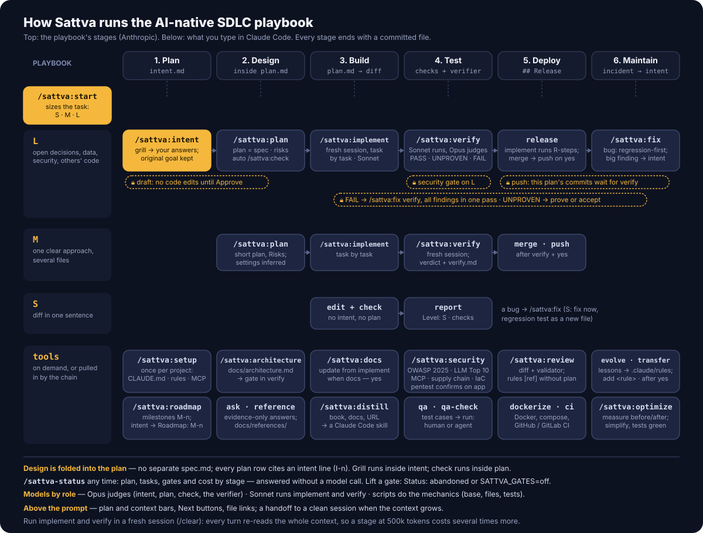

# Справочник по скиллам Sattva

[English](skills.md) · [К README](../README.ru.md)

Все 27 команд `/sattva:*`: какие параметры принимают, что делают, когда их запускать и кто их вызывает. Схема
показывает, где каждая команда стоит на этапах плейбука Anthropic; строки с инструментами под цепочкой необязательны.

<picture>
  
</picture>

## Обозначения

- **Модель.** Opus: суждение (решения, планы, проверки, ревью). Sonnet: исполнение (по готовому плану или рутинная
  генерация). Сессии: у скилла нет своей модели, он идёт на модели вашей сессии. `start` подсказывает, где
  переключиться, а `implement` рассчитан на Sonnet.
- **Может вызвать модель.** Скилл описан так, что Claude может запустить его сам, если запрос подходит. Остальные
  запускаются только вашей командой, поэтому `plan`, `implement` и `fix` не стартуют случайно.
- Параметры: `<обязательный>`, `[необязательный]`, `a | b` — выбор. Взяты из `argument-hint` каждого скилла.

## Цепочка задачи

Основной путь: размер задачи, решения, план, код, проверка. На уровне S остаётся только правка и проверка, на M —
`plan`, `implement` и `verify`.

| Команда | Модель | Параметры | Что делает | Когда применять | Кто вызывает |
|---|---|---|---|---|---|
| `/sattva:start` | сессии; может вызвать модель | `[--rush] <задача своими словами>` | Определяет уровень S, M или L и ведёт по маршруту: S — правка и проверка без плана; M — короткий план; L — intent, plan, implement, verify. `--rush` на M и L: после Approve цепочка сама идёт до вердикта (режим rush, `Pace: rush` в шапке плана). Подсказывает модель для этапа, ограничивает разведку. | В начале любой задачи. Если в проекте нет CLAUDE.md, одной строкой предложит `/sattva:setup`. | Вы. |
| `/sattva:grill` | Opus; может вызвать модель | `[идея, план или вопрос; пусто — тема разговора]` | Допрашивает по всему дереву решений, раунд за раундом: реализация, UX, крайние случаи, сбои, данные, безопасность, что значит «готово». Факты ищет сам, решения оставляет вам. Файлов не пишет, возвращает список решений D1… | Когда решения зависят друг от друга или идею нужно проверить на прочность. | `intent` (на L), `plan` и `fix` при открытых решениях; вы — «допроси меня». |
| `/sattva:intent` | Opus; может вызвать модель | `[--rush] [текст идеи] \| accept <путь к intent.md>` | Записывает `intent.md`: что и зачем, вашими словами; каждая строка с ID `I-n`, журнал «вопрос → ответ». На L при неясном «как» предлагает `research.md` до grill. Может сослаться на веху: `Roadmap: M-n`. `accept` — ваша подпись. | Перед планом изменения уровня L. | `start` на L; вы. |
| `/sattva:plan` | Opus | `<путь к intent.md \| текст задачи> [S \| M \| L] [--rush]` | План — он же спецификация: сверка с intent и правилами проекта, Risks, задачи с файлами и проверками, Done means, Commit Plan. Настройки tests / logging / docs выводит из репозитория, не спрашивает. На L с безопасностью добавляет угрозы. Пока план в draft, хук не даёт править код. | M и L, после intent (на L). | Вы (только явной командой). |
| `/sattva:check` | Opus; может вызвать модель | `[<путь к intent>] [<путь к плану>]` | Независимая проверка плана до Approve: анализатор по коду и валидатор в чистом контексте. Покрытие каждой строки intent, пропущенные и лишние задачи, нарушения правил. План правит только после вашего ответа. | Перед Approve на L; после ретроспективного intent или изменения `intent.md`. | `plan` на L — автоматически; вы. |
| `/sattva:implement` | сессии (Sonnet) | `[путь к plan.md]` | Выполняет одобренный план задача за задачей: галочка после каждой, `BLOCKED` вместо «не запускалось», журнал решений, коммиты по Commit Plan (`commits — end` в Settings — один коммит в конце). При `tests — tdd` каждый тест пишется первым и должен упасть до кода. При `docs — yes` зовёт `/sattva:docs update`; в конце предлагает до трёх новых правил в `.claude/rules/`. На проверенном плане выполняет шаги `## Release` (режим релиза): проверка шага прошла — строки с пометкой `proved by R<n>` получают доказательство в ячейке; не прошла — уходят в долг (`## Debt`). | После Approve, в свежей сессии (`/clear`), на Sonnet. | Вы (только явной командой). |
| `/sattva:verify` | Запускает Sonnet, верификатор (судья) — Opus; может вызвать модель | `[<путь к плану> [base ref]] [--strict] [--full] \| accept \| accept [<путь к плану>] D<k> <доказательство>` | Факты (база диффа, файлы задачи, сборка, тесты, линт) собирает скрипт `collect.mjs`, затем отдельный верификатор в чистом контексте: по каждой задаче, строке сверки и строке intent — ok / missing / wrong / not proven, плюс то, о чём не просили. Гейты архитектуры и безопасности. Вердикт PASS, PASS-UNPROVEN или FAIL; push открывается только после verify. На L строгий режим по умолчанию. Со второго прогона заново судятся только изменённые и незакрытые строки; доказанные `ok`, которых ничего не коснулось, переносятся в `## Carried` с пометкой прогона, а `/sattva:verify <plan> --full` судит всё заново. Правка плана или intent отправляет на суд только затронутые строки; зачёркнутый `~~I-n~~` и его строки уходят из плана (`left the plan:`). Каждая строка `wrong` называет класс находки (`Class:`) и все его места; упавшие сборка или тесты останавливают прогон до судьи (`not judged`, FAIL, `/sattva:fix verify`). Строка, что была `ok` при неизменных файлах и стала `wrong`, — поздняя находка (`Late:`). Находки в строках, которых задача не трогала, — `Advisory`, чисто текстовые — `Minor`: обе остаются в `verify.md` и вердикт не роняют. На L первый прогон с зелёными проверками сразу делает проход — review и security один раз, рядом с судьёй, все находки в том же `verify.md`; блокируют только critical-находки review, и после прохода повторных review и security не предлагается. Строка `BLOCKED`, у которой не менялись ячейка и файлы, ждёт вас без судьи (`Waiting for you:`). После первого PASS поздняя находка, которую судья пометил некритичной, идёт в `Late: <id> (advisory)` и вердикт не роняет. С третьего FAIL-прогона с судьёй судья останавливается (потолок), пока каждая открытая находка не решена — принять, в долг или назад к плану; правка плана или `--full` снимает его на один прогон. `--full` возвращает прежний полный прогон. Находки прохода остаются в своём прогоне, и `/sattva:fix verify` берёт их из того `verify.md`; если ничего не менялось, судья не вызывается (`open findings:` показывает, что осталось, а сорвавшийся проход повторяется по `--full`); поздние advisory-строки и принятые строки паркуются — переносятся без судьи, пока не изменятся их файлы. Два FAIL подряд только по строкам Rules gate сразу дают меню: починить весь класс или осознанно принять нарушение (принятое нарушение — `Accepted violation by …`, только на перечисленные места). Строка сверки с пометкой `proved by R<n>` (её доказывает шаг релиза) получает `pending R<n>`: accept не нужен, PASS возможен, в финальном отчёте она в строке `Pending:`. `accept` записывает принятые строки в раздел долга `## Debt` плана; `accept D<k> <доказательство>` закрывает строку долга после подтверждения, открытый долг виден в отчёте в строке `Debt:`. | После `implement` на M и L; «точно ли готово». | Вы; `start` ведёт к нему. |
| `/sattva:fix` | Opus | `<описание бага или ошибка> \| пусто — продолжить fix-план` | Сначала воспроизведение и падающий тест новым файлом, потом минимальный фикс и та же проверка зелёная. Root cause и Prevention записываются в план. Режимы: исправить сразу (S) или сначала план (M). Хук не даёт править тесты, уже закоммиченные в HEAD. `/sattva:fix verify` чинит все находки последнего FAIL `verify.md` за один проход — с critical-находками review из прохода, без поздних advisory и принятых; на потолке ничего не чинит и отправляет в verify — каждую — весь её класс (`Class:`, в общей точке, если она есть), прогоняет каждый `Repro:` до и после, добавляет по тесту на класс, красному при откате, и сверяет свой diff с правилами проекта до коммита. | Баг, ошибка, регрессия. | Вы (только явной командой). |
| `/sattva:sessions` | Sonnet; может вызвать модель | (без аргументов) | Разбирает дочерние сессии, которые запустила эта главная сессия (только `linked: true`). Готовые — не работают, ветка влита в базовую, нет незакоммиченных файлов, а в своём worktree — и игнорируемых git файлов (`.env`); план на невлитой ветке — `verified` без открытых `R<n>` — архивирует сразу (вернуть — `unarchive_session`). Недоделанной простаивающей пишет одно сообщение с шагом, который агент сделает сам (implement, verify, `fix verify`, коммит). Остальные — в «Ждут тебя» с причиной. Сессию с незакоммиченными файлами или живой дочерней не архивирует никогда; merge, push, релиз, accept и approve остаются за вами. Без инструментов сессий (CLI, `claude -p`) показывает тот же разбор по worktree, только для чтения. | Дочерние сессии копятся. | Хук — автоматически по событию приложения о дочерних сессиях (выключить: `SATTVA_SESSIONS=off`); вы. |
| `/sattva:feedback` | Sonnet; может вызвать модель | `[summary [--since X.Y.Z] \| judge [<путь плана>] \| auto <путь плана>]` | Обратная связь агентов о тексте скиллов цепочки. При включённой настройке плагина `feedback` start, intent, plan, check, implement, verify, fix и review в конце пишут короткий самоотчёт — что было неясно, где агент отступил и почему, что пришлось додумывать, что лишнее; каждый пункт адресован `скилл § раздел`; в чат уходит одна строка, запись — в `~/.claude/sattva-feedback/<проект>/feedback.jsonl` (только эта машина, только дописывание, никуда не отправляется, по правилу без кода проекта и секретов; известные шаблоны секретов маскируются — лучшее усилие). `summary` сворачивает записи всех проектов в повторяющиеся проблемы со счётчиком (`--since` скрывает исправленные версии); `judge <путь плана>` / `judge` запускает агента `sattva:feedback-judge` в чистом контексте: он сверяет отчёты со следами работы (ошибки инструментов, повторы, прерывания, раунды verify, правки пользователя), подтверждает или оспаривает каждое заявление и добавляет то, о чём умолчали, с причиной (текст скилла / агент / окружение). `auto` вызывает `/sattva:verify` на M/L: судья запускается один раз на задачу и только если сигналы того требуют. Выключить: `SATTVA_FEEDBACK=off`. | Узнать, что агенты считают неясным в скиллах; разобрать задачу, которая пошла плохо. | Вы; `/sattva:verify` (`auto`). |

## Контекст проекта

Нативные файлы Claude Code: `CLAUDE.md`, `docs/architecture.md`, `.claude/rules/`. Всё пишется только после показа
диффа и вашего «да»; повторный запуск лишь дописывает недостающее.

| Команда | Модель | Параметры | Что делает | Когда применять | Кто вызывает |
|---|---|---|---|---|---|
| `/sattva:setup` | Opus | `[описание нового проекта; пусто — анализ этого репо]` | Анализирует стек и пишет короткий `CLAUDE.md` (до 60 строк), `.claude/rules/base.md` с соглашениями из кода и `.mcp.json` проекта с секретами только как `${VAR}`. Плагины рекомендует, а не ставит. Если есть `AGENTS.md` без `CLAUDE.md`, не отключает его: импортирует через `@AGENTS.md`. | Один раз на проект: новый, пустой или уже существующий. В конце предлагает architecture, docs, dockerize, ci. | Вы; `start` подсказывает, если нет CLAUDE.md. |
| `/sattva:architecture` | Opus | `[microservices \| layers \| structured \| structured-layers \| structured-vertical \| explicit \| explicit-layers \| explicit-vertical \| explicit-flat]` (алиасы `clean`, `ddd`, `monolith`, `vertical`) | Подбирает паттерн по стеку и коду и сверяет структуру. При расхождении спрашивает, описать ли как есть или взять строгий идеал. Пишет `docs/architecture.md`; у каждого правила MUST NOT есть своя grep-проверка. | После setup, перед структурным рефакторингом, «какую архитектуру выбрать». | Вы. Файл потом проверяет `verify` (Architecture gate). |
| `/sattva:docs` | Sonnet; может вызвать модель | `[update <файлы \| темы>] [--web]` | README как лендинг и страницы в `docs/` по темам, навигация, сбор разрозненных `.md` (ничего не удаляет сам). `update` обновляет только страницы, которые затронула правка. | «Напиши документацию»; после задачи с `docs — yes`. | `implement` (update) при `docs — yes`; вы. |

## Проверки и качество

| Команда | Модель | Параметры | Что делает | Когда применять | Кто вызывает |
|---|---|---|---|---|---|
| `/sattva:security` | Opus; может вызвать модель | `[auth \| injection \| xss \| csrf \| secrets \| crypto \| logging \| api \| infra \| iac \| prompt-injection \| race-condition \| agent \| supply-chain \| <путь> \| <путь к плану>] \| ignore <id> <причина>` | Аудит по OWASP Top 10:2025 (включая A04 криптографию и A09 логирование), OWASP LLM Top 10 2026, настройкам агентов и MCP и собственному MCP-серверу, цепочке поставок и весам моделей, IaC (Dockerfile, Kubernetes, Terraform) и race conditions; у каждой находки строка `Refs:` (OWASP · CWE · ASVS · ISO 27001 A.8.x). Область: весь проект, путь, категория или дифф задачи. У находки серьёзность, `file:line`, как эксплуатировать и как исправить. Исключения — в `docs/sattva/security-ignores.md` с причиной и датой. Итог: `Security gate: pass \| warn \| fail`. Код не меняет. | Перед деплоем; изменения auth, платежей, пользовательского ввода, LLM-вызовов. | `plan` добавляет задачу на L с безопасностью; `verify` требует его итог; вы. |
| `/sattva:review` | Opus | `[номер PR \| URL PR \| ветка/коммит/тег \| пусто = staged]` | Ревью без правок: корректность, безопасность, производительность, правила проекта, архитектура. У каждой находки серьёзность, `file:line`, Repro и исправление. Сомнительные находки тоже показываются, с отметкой уверенности; валидатор в чистом контексте перепроверяет их всегда, недоказанное уходит в Unconfirmed. PR проверяется на его последнем коммите, а не по вашей локальной копии. | Перед push на L, ревью PR, «посмотри мой код». | `verify` рекомендует на L; вы. |
| `/sattva:qa` | Opus | `[--all] [change-summary \| test-plan \| test-cases] [<plan.md \| git ref>]` | Сводка изменений, план и конкретные сценарии ручного тестирования в `<папка задачи>/qa/`. С планом каждый сценарий ссылается на `I-n` и Done means; у сценария указано, где его выполнять; каждая открытая строка долга `## Debt` плана получает сценарий `Covers: D<k>`. | Фича с UI или сложным поведением, «что проверить руками». | Вы. |
| `/sattva:qa-check` | Sonnet | `[human \| agent] [<plan.md \| папка qa \| ветка>]` | Прогоняет сценарии из `/sattva:qa`. `human` ведёт вас по шагам и записывает, что вы увидели; `agent` идёт сам через встроенный браузер или Playwright, CLI, тесты, API. Итог по сценарию pass / fail / blocked с доказательством в `qa/qa-check.md`; повторяемые прогоны сохраняет Playwright-тестами в `qa/replay/`. Пройденный сценарий `Covers: D<k>` закрывает эту строку долга в плане. | После `/sattva:qa`; повторная проверка после фикса. | Вы. |
| `/sattva:ask` | Opus | `<вопрос>` | Отвечает, только если уверенность 100/100 по доказательствам (файлы, вывод команд, документация); иначе `INSUFFICIENT INFORMATION` и что именно нужно. Сначала memlab, библиотеки — через Context7. Файлы не меняет. | «Только если уверен», версии и цены, «поддерживает ли X сейчас Y», вопросы рядом с безопасностью. | Вы. |
| `/sattva:pentest` | Opus | `<URL вашей цели> [<путь к отчёту security>]` | Подтверждает находки `/sattva:security` на вашем работающем приложении — только ваши цели (localhost, `*.test` или staging-URL, который вы назвали своим; прод только по отдельному «да» и только наблюдение). Пассивные проверки (заголовки, CORS, флаги cookie, TLS) по OWASP ZAP baseline, затем один безопасный запрос на находку, чтобы подтвердить или понизить её, с PoC и `Refs:`. Не перебирает пароли, не нагружает, не обходит защиты. | После `/sattva:security`, когда приложение работает локально или на staging; когда гейт `warn`. | Вы; `security` и `verify` предлагают. |
| `/sattva:optimize` | Opus | `perf <функция \| эндпоинт \| запрос \| страница \| бандл> \| simplify <путь>` | `perf`: меряет метрику 3+ раза до и после одной и той же командой и оставляет правку, только если цифры улучшились сверх шума, иначе откат; тесты зелёные. `simplify`: убирает мёртвый код и дубли при зелёных тестах до и после, строк меньше. Ничего не ставит без «да», прод не трогает. | Медленный эндпоинт, запрос или страница; код, который слишком усложнился. | Вы; `review` передаёт ему находку о производительности. |

## Сборка и выкладка

| Команда | Модель | Параметры | Что делает | Когда применять | Кто вызывает |
|---|---|---|---|---|---|
| `/sattva:dockerize` | Sonnet | `[--audit]` | Многостадийный Dockerfile (dev и prod), compose для разработки, усиленный production-оверлей, `.dockerignore`, скрипты деплоя; или аудит существующего с оценкой безопасности. Прокси — по выбору, по умолчанию нет. Пишет после показа файлов и «да». | «Добавь Docker», перед первым деплоем, проверка готового сетапа. | Вы; `setup` предлагает. |
| `/sattva:ci` | Sonnet | `[github \| gitlab] [--enhance]` | Пайплайн GitHub Actions или GitLab CI: отдельный workflow на lint, тесты, сборку и безопасность, только из инструментов, которые реально есть в проекте. Либо улучшает и проверяет существующий. | «Настрой CI», новые линтеры или тесты без job. | Вы; `setup` предлагает. |

## Уроки и знания

| Команда | Модель | Параметры | Что делает | Когда применять | Кто вызывает |
|---|---|---|---|---|---|
| `/sattva:roadmap` | Opus | `[check \| видение или требования проекта]` | `docs/roadmap.md`: вехи `M-1`, `M-2`… с постоянными ID. Режимы: создать, обновить, `check` — сверяет вехи со статусами задач и предлагает отметить готовые. | «Что строим дальше», планирование на месяцы. | Вы; `verify` после PASS предлагает отметить веху из intent. |
| `/sattva:evolve` | Opus | `[all \| plan \| implement \| fix \| verify \| <тема правил>]` | Собирает уроки из Prevention fix-планов, находок verify, review и security, журналов реализации и заметок memlab. Каждому уроку ставит вердикт по тому, что показала история (helped / hurt / no observed effect / confounded); правило — только при выделенном эффекте или повторе, иначе `NO_ENTRY`. Предлагает правила в `.claude/rules/` (не больше 8 за раз, у каждого cue и confidence) и пишет их только после «да». Разобранное отмечает в `docs/sattva/evolve-log.md`. | После нескольких фиксов, «что у нас повторяется». | `verify` рекомендует после fix-плана или исправленного FAIL; вы. |
| `/sattva:transfer` | Opus | `<путь к другому проекту> [all \| этап \| тема правил]` | Берёт правила и уроки другого вашего проекта (только читает его), отбирает подходящие к стеку текущего, помечает источник и пишет в `.claude/rules/` после «да». | Новый проект, похожий на старый; чтобы не повторять уже оплаченные ошибки. | Вы. |
| `/sattva:reference` | Sonnet | `<url \| путь> [url2 \| путь2] [--name <slug>] [--update] \| list \| show <slug> \| delete <slug>` | Справочник в `docs/references/`: выводы под проект, цены и лимиты с датой и источником, живые проверки. Документацию библиотек не копирует — её даёт Context7. | Тарифы и лимиты внешнего API, особенности интеграции, которые нужно помнить. | Вы. |
| `/sattva:distill` | Opus | `<путь \| url> [путь \| url...] [--name <имя>] [--path <папка>] [--update] [--redact-source-map] [--split \| --split-by <стратегия>]` | Превращает книгу, документы, папку или URL в скилл Claude Code (или набор скиллов): короткий `SKILL.md` плюс references и примеры. Спрашивает, куда сохранить — в проект или в `~/.claude/skills`; показывает список файлов до записи. | Методика, регламент или книга, которую агент должен применять. | Вы. |

## Без скилла: команда мода и гейты

| Что | Как работает | Когда |
|---|---|---|
| `/sattva-status` | Активный план, задачи, гейты и стоимость по этапам. Отвечает мод, без запроса к модели — бесплатно. Итог стоимости и так виден в строке состояния после каждого хода. | В любой момент. |
| `/sattva-panel` | Открывает боковую панель (Desktop): кто ждёт вас, субсессии этой сессии, план, проверки, расход. Читает локальные файлы, git и список сессий приложения; модель не вызывает, ничего не отправляет. Отключается опцией плагина `panel`. | Когда закрыли панель или она не открылась сама. |
| Гейты (хуки) | Draft — правки кода закрыты до Approve. Push и PR закрыты до verify (в облачной сессии push в рабочую ветку проходит: облако хранит работу только на удалённой ветке; основная ветка и PR закрыты). Так же закрыты PR, слияние и запись в основную ветку через инструменты GitHub MCP. В fix нельзя менять закоммиченные тесты. Stop один раз напоминает об открытых задачах. Гейты draft и Stop, статус-строка и кнопки касаются только сессии, которая работает с планом (`/sattva:<стадия>` по нему или правка его папки); push — на весь репозиторий. | Работают сами. Снять: `Status: abandoned` в плане или `SATTVA_GATES=off`. |
| Одна сессия на план | `/sattva:implement` и `/sattva:fix` берут план до первой правки: запись владельца (место — папка worktree или облачная сессия, ветка, стадия, время) в служебной ветке `sattva/owners`, уходит в origin — её видят другие worktree, машины и облако; рабочие ветки, `main` и папка плана не меняются. Вторая сессия останавливается с сообщением, кто ведёт план, и спрашивает `Стоп` / `Забрать план`. Владелец отмечается перед каждой задачей и коммитом; без отметки 2 ч запись протухла, и «Забрать» — рекомендованный ответ (но только по выбору человека). Конец прогона, `verified` и `abandoned` снимают запись. Без сети или origin метка локальная, с одним предупреждением. `/sattva:sessions` не будит дочернюю сессию, чей план ведёт другая живая сессия. | Работает само. Выключить: `SATTVA_GATES=off`. |
| Конфликты между worktree | На старте в linked worktree `/sattva:implement` (и `/sattva:fix`, исполняющий fix-план) запускает `worktree-check`: статическое, только чтением, сравнение со всеми живыми worktree репо (основной checkout тоже) host-портов, `container_name`, Compose-проекта, именованных томов и сетей из compose-файлов, `.env*` (`*PORT*`, `COMPOSE_PROJECT_NAME`), `.claude/launch.json` и `scripts` в `package.json`. `${VAR}` берётся из `.env` своего worktree; невычислимое — «не проверено», не конфликт; значения секретов в отчёт не попадают. Конфликт → таблица и подсказка, работа продолжается. Изоляцию не доказывает, ничего не запускает, кроме `git`. | Работает само (implement в linked worktree). Вручную: `node skills/implement/scripts/worktree-check.mjs [--json]` |
