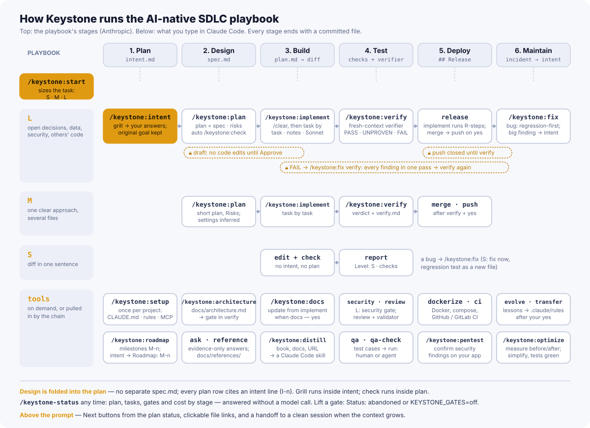

# Справочник по скиллам Keystone

[English](skills.md) · [К README](../README.ru.md)

Все 25 команд `/keystone:*`: какие параметры принимают, что делают, когда их запускать и кто их вызывает. Схема
показывает, где каждая команда стоит на этапах плейбука Anthropic; строки с инструментами под цепочкой необязательны.

<picture>
  <source media="(prefers-color-scheme: dark)" srcset="../assets/flow-dark.svg">
  <source media="(prefers-color-scheme: light)" srcset="../assets/flow-light.svg">
  
</picture>

## Обозначения

- **Модель.** Opus: суждение (решения, планы, проверки, ревью). Sonnet: исполнение (по готовому плану или рутинная
  генерация). Сессии: у скилла нет своей модели, он идёт на модели вашей сессии. `start` подсказывает, где
  переключиться, а `implement` рассчитан на Sonnet.
- **Может вызвать модель.** Скилл описан так, что Claude может запустить его сам, если запрос подходит. Остальные
  запускаются только вашей командой, поэтому `plan`, `implement` и `fix` не стартуют случайно.
- Параметры: `<обязательный>`, `[необязательный]`, `a | b` — выбор. Взяты из `argument-hint` каждого скилла.

## Цепочка задачи

Основной путь: размер задачи, решения, план, код, проверка. На уровне S остаётся только правка и проверка, на M —
`plan`, `implement` и `verify`.

| Команда | Модель | Параметры | Что делает | Когда применять | Кто вызывает |
|---|---|---|---|---|---|
| `/keystone:start` | сессии; может вызвать модель | `<задача своими словами>` | Определяет уровень S, M или L и ведёт по маршруту: S — правка и проверка без плана; M — короткий план; L — intent, plan, implement, verify. Подсказывает модель для этапа, ограничивает разведку. | В начале любой задачи. Если в проекте нет CLAUDE.md, одной строкой предложит `/keystone:setup`. | Вы. |
| `/keystone:grill` | Opus; может вызвать модель | `[идея, план или вопрос; пусто — тема разговора]` | Допрашивает по всему дереву решений, раунд за раундом: реализация, UX, крайние случаи, сбои, данные, безопасность, что значит «готово». Факты ищет сам, решения оставляет вам. Файлов не пишет, возвращает список решений D1… | Когда решения зависят друг от друга или идею нужно проверить на прочность. | `intent` (на L), `plan` и `fix` при открытых решениях; вы — «допроси меня». |
| `/keystone:intent` | Opus; может вызвать модель | `[текст идеи] \| accept <путь к intent.md>` | Записывает `intent.md`: что и зачем, вашими словами; каждая строка с ID `I-n`, журнал «вопрос → ответ». На L при неясном «как» предлагает `research.md` до grill. Может сослаться на веху: `Roadmap: M-n`. `accept` — ваша подпись. | Перед планом изменения уровня L. | `start` на L; вы. |
| `/keystone:plan` | Opus | `<путь к intent.md \| текст задачи> [S \| M \| L]` | План — он же спецификация: сверка с intent и правилами проекта, Risks, задачи с файлами и проверками, Done means, Commit Plan. Настройки tests / logging / docs выводит из репозитория, не спрашивает. На L с безопасностью добавляет угрозы. Пока план в draft, хук не даёт править код. | M и L, после intent (на L). | Вы (только явной командой). |
| `/keystone:check` | Opus; может вызвать модель | `[<путь к intent>] [<путь к плану>]` | Независимая проверка плана до Approve: анализатор по коду и валидатор в чистом контексте. Покрытие каждой строки intent, пропущенные и лишние задачи, нарушения правил. План правит только после вашего ответа. | Перед Approve на L; после ретроспективного intent или изменения `intent.md`. | `plan` на L — автоматически; вы. |
| `/keystone:implement` | сессии (Sonnet) | `[путь к plan.md]` | Выполняет одобренный план задача за задачей: галочка после каждой, `BLOCKED` вместо «не запускалось», журнал решений, коммиты по Commit Plan. При `docs — yes` зовёт `/keystone:docs update`; в конце предлагает до трёх новых правил в `.claude/rules/`. | После Approve, в свежей сессии (`/clear`), на Sonnet. | Вы (только явной командой). |
| `/keystone:verify` | Opus; может вызвать модель | `[<путь к плану> [base ref]] [--strict] \| accept` | Сборка, тесты и линт, затем отдельный верификатор в чистом контексте: по каждой задаче, строке сверки и строке intent — ok / missing / wrong / not proven, плюс то, о чём не просили. Гейты архитектуры и безопасности. Вердикт PASS, PASS-UNPROVEN или FAIL; push открывается только после verify. На L строгий режим по умолчанию. | После `implement` на M и L; «точно ли готово». | Вы; `start` ведёт к нему. |
| `/keystone:fix` | Opus | `<описание бага или ошибка> \| пусто — продолжить fix-план` | Сначала воспроизведение и падающий тест новым файлом, потом минимальный фикс и та же проверка зелёная. Root cause и Prevention записываются в план. Режимы: исправить сразу (S) или сначала план (M). Хук не даёт править тесты, уже закоммиченные в HEAD. | Баг, ошибка, регрессия. | Вы (только явной командой). |

## Контекст проекта

Нативные файлы Claude Code: `CLAUDE.md`, `docs/architecture.md`, `.claude/rules/`. Всё пишется только после показа
диффа и вашего «да»; повторный запуск лишь дописывает недостающее.

| Команда | Модель | Параметры | Что делает | Когда применять | Кто вызывает |
|---|---|---|---|---|---|
| `/keystone:setup` | Opus | `[описание нового проекта; пусто — анализ этого репо]` | Анализирует стек и пишет короткий `CLAUDE.md` (до 60 строк), `.claude/rules/base.md` с соглашениями из кода и `.mcp.json` проекта с секретами только как `${VAR}`. Плагины рекомендует, а не ставит. Если есть `AGENTS.md` без `CLAUDE.md`, не отключает его: импортирует через `@AGENTS.md`. | Один раз на проект: новый, пустой или уже существующий. В конце предлагает architecture, docs, dockerize, ci. | Вы; `start` подсказывает, если нет CLAUDE.md. |
| `/keystone:architecture` | Opus | `[microservices \| layers \| structured \| structured-layers \| structured-vertical \| explicit \| explicit-layers \| explicit-vertical \| explicit-flat]` (алиасы `clean`, `ddd`, `monolith`, `vertical`) | Подбирает паттерн по стеку и коду и сверяет структуру. При расхождении спрашивает, описать ли как есть или взять строгий идеал. Пишет `docs/architecture.md`; у каждого правила MUST NOT есть своя grep-проверка. | После setup, перед структурным рефакторингом, «какую архитектуру выбрать». | Вы. Файл потом проверяет `verify` (Architecture gate). |
| `/keystone:docs` | Sonnet; может вызвать модель | `[update <файлы \| темы>] [--web]` | README как лендинг и страницы в `docs/` по темам, навигация, сбор разрозненных `.md` (ничего не удаляет сам). `update` обновляет только страницы, которые затронула правка. | «Напиши документацию»; после задачи с `docs — yes`. | `implement` (update) при `docs — yes`; вы. |

## Проверки и качество

| Команда | Модель | Параметры | Что делает | Когда применять | Кто вызывает |
|---|---|---|---|---|---|
| `/keystone:security` | Opus; может вызвать модель | `[auth \| injection \| xss \| csrf \| secrets \| api \| infra \| prompt-injection \| race-condition \| agent \| supply-chain \| <путь> \| <путь к плану>] \| ignore <id> <причина>` | Аудит по OWASP Top 10:2025, OWASP LLM Top 10 2026, настройкам агентов и MCP, цепочке поставок и race conditions; у каждой находки строка `Refs:` (OWASP · CWE · ASVS · ISO 27001 A.8.x). Область: весь проект, путь, категория или дифф задачи. У находки серьёзность, `file:line`, как эксплуатировать и как исправить. Исключения — в `docs/keystone/security-ignores.md` с причиной и датой. Итог: `Security gate: pass \| warn \| fail`. Код не меняет. | Перед деплоем; изменения auth, платежей, пользовательского ввода, LLM-вызовов. | `plan` добавляет задачу на L с безопасностью; `verify` требует его итог; вы. |
| `/keystone:review` | Opus | `[номер PR \| URL PR \| ветка/коммит/тег \| пусто = staged]` | Ревью без правок: корректность, безопасность, производительность, правила проекта, архитектура. У каждой находки серьёзность, `file:line`, Repro и исправление. Валидатор в чистом контексте перепроверяет всегда; недоказанное уходит в Unconfirmed. | Перед push на L, ревью PR, «посмотри мой код». | `verify` рекомендует на L; вы. |
| `/keystone:qa` | Opus | `[--all] [change-summary \| test-plan \| test-cases] [<plan.md \| git ref>]` | Сводка изменений, план и конкретные сценарии ручного тестирования в `<папка задачи>/qa/`. С планом каждый сценарий ссылается на `I-n` и Done means; у сценария указано, где его выполнять. | Фича с UI или сложным поведением, «что проверить руками». | Вы. |
| `/keystone:qa-check` | Sonnet | `[human \| agent] [<plan.md \| папка qa \| ветка>]` | Прогоняет сценарии из `/keystone:qa`. `human` ведёт вас по шагам и записывает, что вы увидели; `agent` идёт сам через встроенный браузер или Playwright, CLI, тесты, API. Итог по сценарию pass / fail / blocked с доказательством в `qa/qa-check.md`; повторяемые прогоны сохраняет Playwright-тестами в `qa/replay/`. | После `/keystone:qa`; повторная проверка после фикса. | Вы. |
| `/keystone:ask` | Opus | `<вопрос>` | Отвечает, только если уверенность 100/100 по доказательствам (файлы, вывод команд, документация); иначе `INSUFFICIENT INFORMATION` и что именно нужно. Сначала memlab, библиотеки — через Context7. Файлы не меняет. | «Только если уверен», версии и цены, «поддерживает ли X сейчас Y», вопросы рядом с безопасностью. | Вы. |
| `/keystone:pentest` | Opus | `<URL вашей цели> [<путь к отчёту security>]` | Подтверждает находки `/keystone:security` на вашем работающем приложении — только ваши цели (localhost, `*.test` или staging-URL, который вы назвали своим; прод только по отдельному «да» и только наблюдение). Пассивные проверки (заголовки, CORS, флаги cookie, TLS) по OWASP ZAP baseline, затем один безопасный запрос на находку, чтобы подтвердить или понизить её, с PoC и `Refs:`. Не перебирает пароли, не нагружает, не обходит защиты. | После `/keystone:security`, когда приложение работает локально или на staging; когда гейт `warn`. | Вы; `security` и `verify` предлагают. |
| `/keystone:optimize` | Opus | `perf <функция \| эндпоинт \| запрос \| страница \| бандл> \| simplify <путь>` | `perf`: меряет метрику 3+ раза до и после одной и той же командой и оставляет правку, только если цифры улучшились сверх шума, иначе откат; тесты зелёные. `simplify`: убирает мёртвый код и дубли при зелёных тестах до и после, строк меньше. Ничего не ставит без «да», прод не трогает. | Медленный эндпоинт, запрос или страница; код, который слишком усложнился. | Вы; `review` передаёт ему находку о производительности. |

## Сборка и выкладка

| Команда | Модель | Параметры | Что делает | Когда применять | Кто вызывает |
|---|---|---|---|---|---|
| `/keystone:dockerize` | Sonnet | `[--audit]` | Многостадийный Dockerfile (dev и prod), compose для разработки, усиленный production-оверлей, `.dockerignore`, скрипты деплоя; или аудит существующего с оценкой безопасности. Прокси — по выбору, по умолчанию нет. Пишет после показа файлов и «да». | «Добавь Docker», перед первым деплоем, проверка готового сетапа. | Вы; `setup` предлагает. |
| `/keystone:ci` | Sonnet | `[github \| gitlab] [--enhance]` | Пайплайн GitHub Actions или GitLab CI: отдельный workflow на lint, тесты, сборку и безопасность, только из инструментов, которые реально есть в проекте. Либо улучшает и проверяет существующий. | «Настрой CI», новые линтеры или тесты без job. | Вы; `setup` предлагает. |

## Уроки и знания

| Команда | Модель | Параметры | Что делает | Когда применять | Кто вызывает |
|---|---|---|---|---|---|
| `/keystone:roadmap` | Opus | `[check \| видение или требования проекта]` | `docs/roadmap.md`: вехи `M-1`, `M-2`… с постоянными ID. Режимы: создать, обновить, `check` — сверяет вехи со статусами задач и предлагает отметить готовые. | «Что строим дальше», планирование на месяцы. | Вы; `verify` после PASS предлагает отметить веху из intent. |
| `/keystone:evolve` | Opus | `[all \| plan \| implement \| fix \| verify \| <тема правил>]` | Собирает уроки из Prevention fix-планов, находок verify, review и security, журналов реализации и заметок memlab. Предлагает правила в `.claude/rules/` (не больше 8 за раз) и пишет их только после «да». Разобранное отмечает в `docs/keystone/evolve-log.md`. | После нескольких фиксов, «что у нас повторяется». | `verify` рекомендует после fix-плана или исправленного FAIL; вы. |
| `/keystone:transfer` | Opus | `<путь к другому проекту> [all \| этап \| тема правил]` | Берёт правила и уроки другого вашего проекта (только читает его), отбирает подходящие к стеку текущего, помечает источник и пишет в `.claude/rules/` после «да». | Новый проект, похожий на старый; чтобы не повторять уже оплаченные ошибки. | Вы. |
| `/keystone:reference` | Sonnet | `<url \| путь> [url2 \| путь2] [--name <slug>] [--update] \| list \| show <slug> \| delete <slug>` | Справочник в `docs/references/`: выводы под проект, цены и лимиты с датой и источником, живые проверки. Документацию библиотек не копирует — её даёт Context7. | Тарифы и лимиты внешнего API, особенности интеграции, которые нужно помнить. | Вы. |
| `/keystone:distill` | Opus | `<путь \| url> [путь \| url...] [--name <имя>] [--path <папка>] [--update] [--redact-source-map] [--split \| --split-by <стратегия>]` | Превращает книгу, документы, папку или URL в скилл Claude Code (или набор скиллов): короткий `SKILL.md` плюс references и примеры. Спрашивает, куда сохранить — в проект или в `~/.claude/skills`; показывает список файлов до записи. | Методика, регламент или книга, которую агент должен применять. | Вы. |

## Без скилла: команда мода и гейты

| Что | Как работает | Когда |
|---|---|---|
| `/keystone-status` | Активный план, задачи, гейты и стоимость по этапам. Отвечает мод, без запроса к модели — бесплатно. Итог стоимости и так виден в строке состояния после каждого хода. | В любой момент. |
| Гейты (хуки) | Draft — правки кода закрыты до Approve. Push и PR закрыты до verify. В fix нельзя менять закоммиченные тесты. Stop один раз напоминает об открытых задачах. Гейты draft и Stop, статус-строка и кнопки касаются только сессии, которая работает с планом (`/keystone:<стадия>` по нему или правка его папки); push — на весь репозиторий. | Работают сами. Снять: `Status: abandoned` в плане или `KEYSTONE_GATES=off`. |
